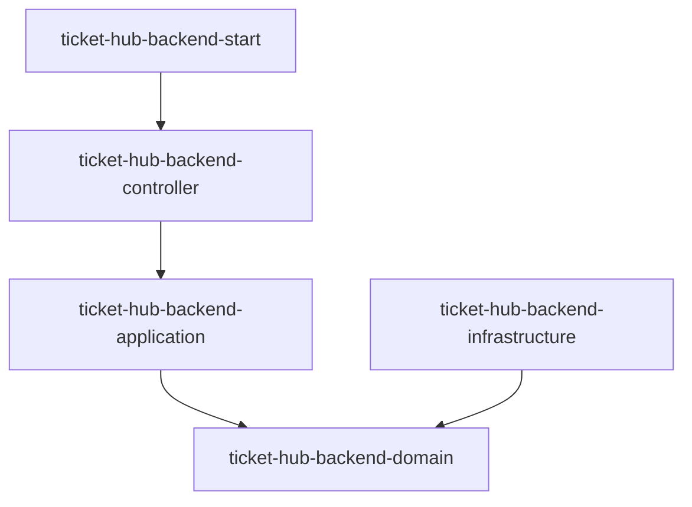
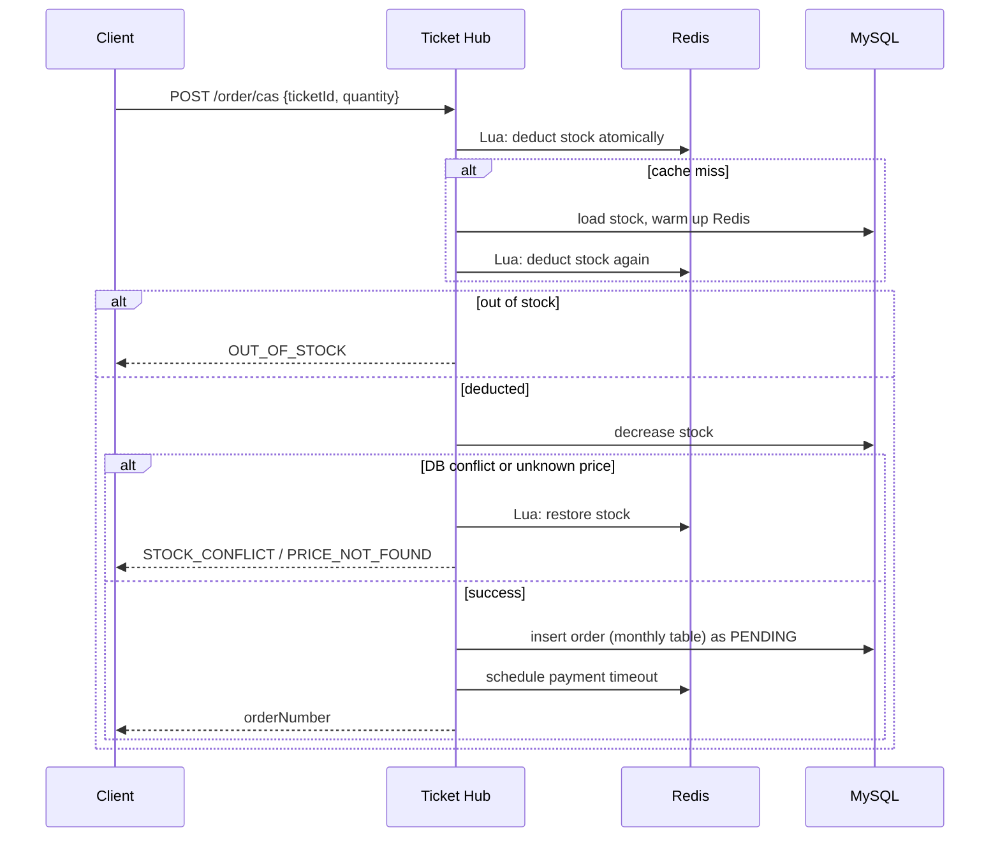
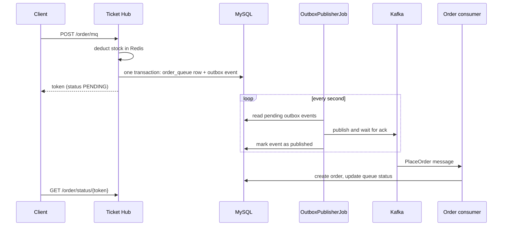
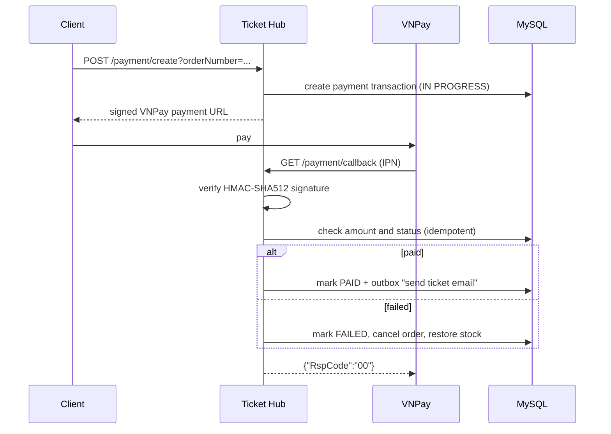

# Ticket Hub

Backend for an event ticket booking platform, built to survive flash-sale traffic without overselling.

The project focuses on the hard parts of ticketing: many users competing for limited stock, payments that can fail or arrive twice, and messages that must not be lost when a broker is down.


## Highlights

- **No overselling under concurrency**: stock is deducted atomically in Redis with Lua scripts, confirmed in MySQL, and rolled back in Redis if the database step fails.
- **Asynchronous booking with Kafka** using the **Transactional Outbox** pattern, so orders and emails are never lost if Kafka is unavailable. Consumers are idempotent.
- **Multi-level cache** (Guava local cache → Redis → MySQL) with **Redisson distributed locks** and double-checked loading to prevent cache stampede.
- **VNPay payment integration**: HMAC-SHA512 signature verification, amount validation and idempotent IPN handling. Failed payments cancel the order and release stock.
- **JWT authentication** with access/refresh tokens, Redis-backed logout blacklist and email OTP verification.
- **Rate limiting** in Redis, per IP/user for every endpoint and per account for login and OTP attempts. Returns `429` with `Retry-After`.
- **Observability**: Prometheus, Grafana and ELK via Docker Compose. Load tests with k6 and JMeter.

## Tech stack

| Area | Technology |
|---|---|
| Language / framework | Java 25, Spring Boot 3.5, Spring Security, Spring Data JPA |
| Storage | MySQL 8 (orders partitioned into monthly tables), Redis 8 |
| Concurrency / cache | Redis Lua scripts, Redisson, Guava Cache |
| Messaging | Apache Kafka 4 |
| Payment | VNPay sandbox |
| Email | Spring Mail, Thymeleaf templates |
| Testing | JUnit 5, Mockito, MockMvc |
| Infrastructure | Docker Compose, Nginx, Prometheus, Grafana, Elasticsearch, Logstash |
| Load testing | k6, JMeter |
| Frontend (in progress) | React 19, Vite, Tailwind CSS |

## Architecture

The backend is a multi-module Maven project following **Domain-Driven Design**. Dependencies point inwards: the domain knows nothing about Spring MVC, Redis or Kafka.



| Module | Responsibility |
|---|---|
| `ticket-hub-backend-domain` | Entities (`Ticket`, `TicketDetail`, `TicketOrder`, `PaymentTransaction`, `User`, `Role`, `OutboxEvent`…), repository interfaces, domain services |
| `ticket-hub-backend-infrastructure` | Repository implementations, Redis access, distributed locks, rate limiter, Kafka producers, VNPay gateway |
| `ticket-hub-backend-application` | Booking, payment and authentication use cases, multi-level cache, outbox publisher, scheduled jobs, Kafka consumers |
| `ticket-hub-backend-controller` | REST API, Spring Security configuration, JWT filter, `@RateLimit` interceptor |
| `ticket-hub-backend-start` | Application entry point and `application.yml` |

## Key flows

### Booking (synchronous)



### Booking through Kafka with Transactional Outbox



If Kafka is down, the event stays pending in the outbox table and is retried on the next run, so the request is never lost. Because an event may be published more than once, consumers check an idempotency key before processing.

### Payment with VNPay



IPN codes returned: `00` confirmed, `01` payment not found, `02` already processed, `04` invalid amount, `97` invalid signature, `99` unknown error.

## Getting started

### Prerequisites

- JDK 25
- Maven 3.9+
- Docker and Docker Compose
- Node.js 20+ (only for the frontend)

### 1. Start the infrastructure

```bash
cd environment
docker compose -f docker-compose-mininal.yaml up -d
```

This starts MySQL, Redis, Kafka, Kafka UI, Prometheus and Grafana. The database schema and seed data are loaded from `environment/mysql/init/ticket_init.sql`.

Other compose files:

| File | Contents |
|---|---|
| `docker-compose-mininal.yaml` | MySQL, Redis, Kafka, monitoring (recommended for local development) |
| `docker-compose-dev.yml` | MySQL, Redis, exporters, Prometheus, Grafana, Elasticsearch, Logstash |
| `docker-compose-broker-kafka.yaml` | Kafka and Kafka UI only |
| `docker-compose-nginx.yaml` | Full stack behind Nginx |

### 2. Configure environment variables

Create a `.env` file in the project root (it is git-ignored) and fill in your own values:

```properties
# Database
MYSQL_URL=jdbc:mysql://localhost:3316/<database>
MYSQL_ROOT_USERNAME=
MYSQL_ROOT_PASSWORD=

# VNPay sandbox
TERMINAL_ID=
SECRET_KEY=
VNP_URL=https://sandbox.vnpayment.vn/paymentv2/vpcpay.html
IP=http://localhost

# JWT (Base64-encoded keys, at least 512 bits)
EXPIRY_MINUTES=15
EXPIRY_DAY=7
ACCESS_KEY=
REFRESH_KEY=

# Gmail app password used to send OTP and ticket emails
MAIL_PASSWORD=
```

Spring Boot does not read `.env` files by itself. Export the variables in your shell, or load the file in your IDE run configuration (for example with the EnvFile plugin in IntelliJ IDEA).

### 3. Run the backend

```bash
mvn clean install -DskipTests
mvn -pl ticket-hub-backend-start spring-boot:run
```

The API is available at `http://localhost:1122`.

### 4. Run the frontend (optional)

```bash
cd ticket-hub-frontend
npm install
npm run dev
```

The frontend runs at `http://localhost:5173`. It currently contains the home page only.

### Local services

| Service | URL |
|---|---|
| Backend API | http://localhost:1122 |
| Kafka UI | http://localhost:8989 |
| Grafana | http://localhost:3000 |
| Prometheus | http://localhost:9090 |
| MySQL | localhost:3316 |
| Redis | localhost:6319 |
| Kafka | localhost:9094 |

## API overview

Public endpoints (no token required): everything under `/identity/auth/**` and `/payment/callback`. All other endpoints require `Authorization: Bearer <access token>`.

| Method | Endpoint | Description |
|---|---|---|
| POST | `/identity/auth/register` | Register; sends a verification OTP by email |
| POST | `/identity/auth/confirm` | Verify the OTP and receive tokens |
| POST | `/identity/auth/login` | Log in with username, email or phone number |
| POST | `/identity/logout` | Log out and blacklist the current token |
| GET | `/ticket?status=1&version=` | List tickets by status (multi-level cache) |
| GET | `/ticket/{ticketId}` | Ticket information |
| GET | `/ticket/{ticketId}/detail/{detailId}` | Ticket type, price and stock |
| POST | `/order/cas` | Book tickets synchronously |
| POST | `/order/mq` | Book tickets through Kafka; returns a token |
| GET | `/order/status/{token}` | Status of a queued booking |
| GET | `/order/{userId}/list/page?nTable=yyyyMM&cursor=&limit=` | Orders with cursor pagination |
| GET | `/order/{userId}/{orderNumber}` | Order details |
| DELETE | `/order/{userId}/{orderNumber}/cancel` | Cancel an order and restore stock |
| POST | `/payment/create?orderNumber=&method=` | Create a VNPay payment URL |
| GET | `/payment/callback` | VNPay IPN callback |
| GET | `/payment` | List payments (admin) |
| POST | `/export?nTable=yyyyMM` | Export orders to Excel (admin) |

All responses use the same envelope:

```json
{
  "status": 200,
  "message": "Place order cas successful",
  "data": { },
  "timestamp": 1760342400000
}
```

## Testing

```bash
mvn test
```

194 unit tests cover payments and VNPay IPN handling, JWT and authentication, booking and cancellation, caching, the outbox publisher, rate limiting and every REST controller. They use Mockito and MockMvc in standalone mode, so they run without MySQL, Redis or Kafka.

| Module | Tests |
|---|---|
| domain | 15 |
| infrastructure | 12 |
| application | 133 |
| controller | 34 |

[//]: # (## Load testing)

[//]: # ()
[//]: # (Load test scripts are in `benchmark/`:)

[//]: # ()
[//]: # (- `benchmark/k6/flash-sale.js` simulates many users booking the same ticket at once.)

[//]: # (- `benchmark/jmeter/` contains a JMeter test plan.)

[//]: # ()
[//]: # (```bash)

[//]: # (k6 run benchmark/k6/flash-sale.js)

[//]: # (```)

[//]: # ()
[//]: # (<!-- Fill in with your own measured results, for example:)

[//]: # (| Scenario | Virtual users | Throughput | p95 latency | Oversold tickets |)

[//]: # (|---|---|---|---|---|)

[//]: # (| POST /order/cas | ... | ... req/s | ... ms | 0 |)

[//]: # (-->)

## Roadmap

- [ ] Forgot / reset password flow
- [ ] Refresh-token endpoint
- [ ] Automatic cancellation of unpaid orders (timeout worker)
- [ ] Reconciliation job for payments stuck in progress
- [ ] Take `userId` from the token instead of the URL for order endpoints
- [ ] Integration tests with Testcontainers (MySQL, Redis, Kafka)
- [ ] Frontend: login, booking, payment and order history pages
- [ ] CI pipeline (GitHub Actions)

## Author

**Luong Tan Dat** — [GitHub @Dat]([https://github.com/luongtandat03](https://github.com/luongtandat03))
